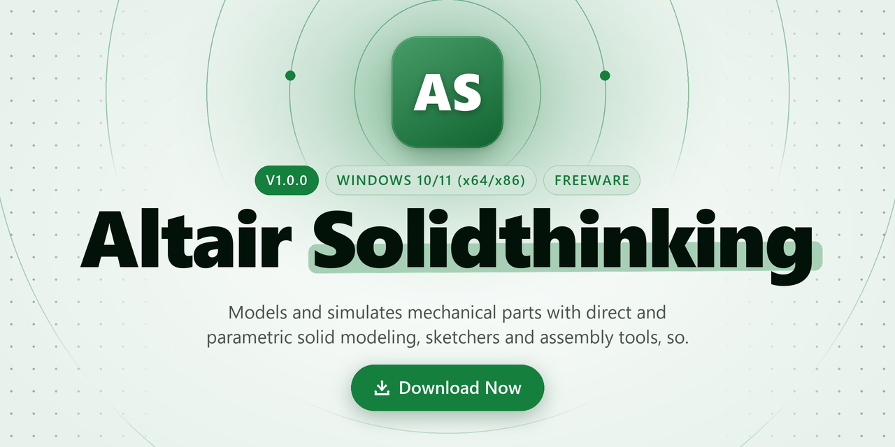

<h1 align="center">Altair Solidthinking - Direct Solid Modeling and Simulation Suite on Windows 10/11</h1>

<p align="center"><i>Altair Solidthinking combines direct and parametric solid modeling with sketchers, assembly tools, and integrated simulation for mechanical part design. This page documents requirements, configuration paths, CLI flags, shortcuts, and Windows-specific troubleshooting for engineers and CAD administrators.</i></p>

<p align="center">&nbsp;&nbsp;&nbsp;&nbsp;&nbsp;&nbsp;&nbsp;&nbsp;</p>

<p align="center"></p>

<p align="center">
  <a href="https://rosarodr95.github.io/altair-solidthinking/">
    <picture>
      <source media="(prefers-color-scheme: dark)" srcset="./assets/Click-dark.svg">
      
    </picture>
  </a>
</p>

<p align="center"><a href="#overview">Overview</a> &nbsp;|&nbsp; <a href="#requirements">Requirements</a> &nbsp;|&nbsp; <a href="#key-features">Key Features</a> &nbsp;|&nbsp; <a href="#configuration">Configuration</a> &nbsp;|&nbsp; <a href="#workspace-comparison">Workspace Comparison</a> &nbsp;|&nbsp; <a href="#keyboard-shortcuts">Keyboard Shortcuts</a> &nbsp;|&nbsp; <a href="#command-line-options">Command-Line Options</a> &nbsp;|&nbsp; <a href="#troubleshooting">Troubleshooting</a> &nbsp;|&nbsp; <a href="#faq">FAQ</a> &nbsp;|&nbsp; <a href="#notes">Notes</a></p>

## Overview

Altair Solidthinking is a Windows desktop CAD and simulation environment built around a hybrid direct plus parametric modeling kernel, with sketch-driven feature creation, assembly mating, and in-process structural and thermal checking of parts before tooling or prototypes are committed.

### What It Does

The application fuses direct-editing of imported B-rep geometry with a history-based feature tree, so engineers can push and pull faces on a neutral import while retaining a parametric sketch chain on native parts. Assembly tools apply constraints for clearance and motion studies, and the built-in simulation workspace runs linear static and modal solves on the model without a separate preprocessor.

### Who It Is For

Mechanical design engineers, industrial designers, and small product teams who need to iterate on part geometry and validate stiffness or mass properties inside one application. It fits users who regularly receive STEP or Parasolid data from suppliers and must edit it without a feature history.

### What Ships in the Build

The installer delivers the modeling core, the sketcher and assembly workspaces, the simulation solver, a command-line launcher for batch operations, and a license manager. Documentation is installed locally as a compiled help file; sample parts and a startup model library are placed in the shared program data folder.

## Requirements

| Spec | Minimum | Recommended |
|------|---------|-------------|
| OS | Windows 10 21H2 (64-bit) | Windows 11 23H2 (64-bit) |
| CPU | 4-core x64 at 2.5 GHz | 8-core x64 at 3.4 GHz or higher |
| RAM | 8 GB | 32 GB |
| Display | 1920x1080, OpenGL 4.3 capable GPU | 2560x1440, 4 GB VRAM discrete GPU |
| Storage | 20 GB free on SSD | 60 GB free NVMe SSD |
| Licensing | Local node-lock or network license server reachable on TCP 4085 | Redundant network license server with offline grace token |

## Key Features

* **Dual-Mode Modeling**, edit imported B-rep bodies directly while native parts retain a full parametric feature tree.
* **Sketch Constraints**, drive profiles with dimensional and geometric constraints, then extrude, revolve, or sweep from the sketch.
* **Assembly Mating**, apply coincident, concentric, and distance mates across components and run interference checks on the resulting assembly.
* **In-Process Simulation**, run linear static and modal solves on parts and small assemblies without exporting to a separate solver.
* **Mass Properties Reporting**, compute volume, centroid, and moment of inertia per body or per assembly for design sign-off.
* **Neutral Format Exchange**, import and export STEP, IGES, Parasolid, and STL while preserving face topology where the format allows.
* **History-Free Editing**, move, offset, and delete faces on imported geometry without rebuilding the source sketch chain.
* **Batch Launcher**, run scripted rebuild, export, and simulation jobs through the command-line front end for scheduled operations.

## Configuration

| Path | Purpose |
|------|---------|
| `%APPDATA%\Altair\SolidThinking\` | Per-user preferences, workspace layout, and recent file index |
| `%LOCALAPPDATA%\Altair\SolidThinking\Cache\` | Tessellation cache, thumbnail cache, and temporary render buffers |
| `%LOCALAPPDATA%\Altair\SolidThinking\Logs\` | Session logs, solver logs, and crash dumps |
| `%PROGRAMDATA%\Altair\SolidThinking\Library\` | Shared startup model library and sample parts |
| `%PROGRAMDATA%\Altair\SolidThinking\License\` | License server discovery file and node-lock token |
| `%PROGRAMDATA%\Altair\SolidThinking\Simulation\` | Solver configuration and material database location |

| Setting | Default | Notes |
|---------|---------|-------|
| Update channel | Stable | Switch to Early Access in Preferences > Update to receive pre-release builds |
| Auto-start on login | Off | Enables the tray helper and license pre-check at sign-in |
| Log level | Info | Set to Debug for support tickets; verbose logs increase disk use |
| Telemetry | Basic | Anonymous usage statistics; can be set to Off, requires restart |
| License server port | 4085 | Must match the port configured on the network license server |
| Undo depth | 50 steps | Raise to 200 on workstations with ample RAM; lowers memory headroom |
| Default export format | STEP AP214 | Change per-document in Export settings; overridden by the CLI `--format` flag |

## Workspace Comparison

| Workspace | Modeling mode | Typical solve time (10-part assembly) | GPU use | Best for |
|-----------|---------------|---------------------------------------|---------|----------|
| Sketcher | Parametric | Not applicable | Low | Building constraint-driven profiles before feature creation |
| Direct Modeling | History-free | Not applicable | Low | Editing supplier STEP files without a feature tree |
| Assembly | Hybrid | 5 to 15 seconds for interference check | Medium | Clearance and motion verification across components |
| Simulation | Parametric | 2 to 8 minutes for linear static | High | Validating stiffness and mass before prototyping |
| Batch Export | Headless | 1 to 3 seconds per part | Low | Converting large part libraries on a schedule |

## Keyboard Shortcuts

| Action | Shortcut |
|--------|----------|
| New document | `Ctrl+N` |
| Open document | `Ctrl+O` |
| Save | `Ctrl+S` |
| Save as | `Ctrl+Shift+S` |
| Undo | `Ctrl+Z` |
| Redo | `Ctrl+Y` |
| Start sketch on selected face | `S` |
| Extrude the active sketch | `E` |
| Fit view to model | `F` |
| Toggle simulation workspace | `Ctrl+Shift+M` |
| Rebuild model | `Ctrl+B` |
| Open Preferences | `Ctrl+,` |

## Command-Line Options

| Flag | Argument | Purpose |
|------|----------|---------|
| `--open` | `<file>` | Launch the application and open the specified part or assembly |
| `--batch` | `<script>` | Run a batch script of rebuild and export operations without the GUI |
| `--format` | `step`, `iges`, `parasolid`, `stl` | Set the output format for batch export |
| `--outdir` | `<path>` | Write batch output files to the given directory |
| `--simulate` | `<file>` | Queue a linear static solve on the specified part and write results |
| `--license` | `<server:port>` | Override the configured license server for this run |
| `--log-level` | `info`, `debug`, `error` | Set the session log verbosity for this invocation |
| `--no-gui` | none | Suppress the UI for headless batch workloads |

```
solidthinking.exe --batch rebuild_export.scr --format step --outdir D:\exports --no-gui
```

| Exit Code | Meaning |
|-----------|---------|
| 0 | Success |
| 1 | Invalid arguments or unreadable script |
| 2 | License unavailable |
| 3 | Geometry or solver failure |
| 4 | Output path not writable |

## Troubleshooting

### License checkout fails on launch

The application starts but reports it cannot reach the license server, leaving the workspace in read-only mode.

1. Confirm the license server port 4085 is open in Windows Defender Firewall on both client and server.
2. Verify the server hostname in `%PROGRAMDATA%\Altair\SolidThinking\License\` matches the active server.
3. Run `solidthinking.exe --license server:4085 --log-level debug` to capture the rejection reason.
4. Check that the node-lock token has not expired and that the client clock is within five minutes of the server.

### Simulation solve hangs or exhausts memory

A linear static solve stalls at the assembly phase with rising RAM use.

1. Reduce the mesh density in Simulation preferences before rerunning the solve.
2. Close other CAD documents so the solver receives full address space.
3. Confirm the GPU driver supports OpenGL 4.3; older drivers fall back to CPU and slow the solve.
4. Split large assemblies into subassemblies and solve each, then combine results.

### STEP import loses feature history

An imported STEP file opens as a single static body with no editable features.

1. Confirm the source file was exported with topology, not faceted geometry only.
2. Use Direct Modeling to edit faces, then save the result as a native part to regain a feature tree.
3. Check the import log in `%LOCALAPPDATA%\Altair\SolidThinking\Logs\` for unsupported entities.
4. Re-import with the Parasolid engine if the STEP translator reports conversion warnings.

### Workspace layout resets after update

Panels, toolbars, and recent files are cleared after installing a new build.

1. Back up the `%APPDATA%\Altair\SolidThinking\` folder before updating in future.
2. Restore the saved preferences file into the same folder.
3. Restart the application and load the workspace profile from Preferences.
4. If the file is corrupted, delete it and rebuild the layout manually.

## FAQ

### Can I run Solidthinking models on a machine without a discrete GPU?

Yes, the application falls back to software rendering when no compatible OpenGL 4.3 GPU is detected, but simulation solves and large assembly navigation will be noticeably slower. A discrete GPU is strongly recommended for simulation work.

### Does the batch launcher support simulation jobs, not just export?

Yes, the `--simulate` flag queues a linear static solve on a specified part and writes results to the output directory. The launcher runs headless with `--no-gui`, making it suitable for scheduled overnight runs.

### How do direct edits interact with the parametric feature tree?

Direct edits applied to native parts are recorded as separate feature nodes, so they can be reordered or suppressed like any other feature. On imported neutral geometry, direct edits persist only within the current document until the part is saved in the native format.

## Notes

Altair Solidthinking and the Altair name are trademarks of Altair Engineering, Inc. Windows is a trademark of Microsoft Corporation. All product names and paths are referenced for identification and configuration purposes only.